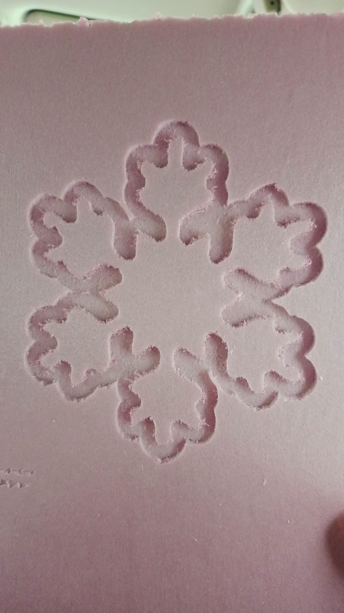

# Práctica 4: Máquinas CNC

**Asignatura:** Proyecto de Ingeniería
**Tema:** Maquinado por Control Numérico Computarizado (CNC)
**Proyecto realizado:** Copo de nieve

## I. Objetivo

Conocer el funcionamiento de las máquinas CNC y comprender cómo se utilizan para fabricar piezas a partir de un diseño digital. Durante esta práctica, se buscó identificar las etapas necesarias para preparar un diseño, configurar el proceso de corte y obtener una pieza física, aplicando medidas de seguridad y considerando las características del material utilizado.

## II. Introducción

Las máquinas CNC, cuyo nombre proviene de *Computer Numerical Control* o Control Numérico Computarizado, son equipos que realizan operaciones de fabricación mediante instrucciones programadas por computadora. Estas máquinas pueden mover una herramienta de corte siguiendo trayectorias específicas para dar forma a distintos materiales.

Su uso permite fabricar piezas con mayor precisión y repetir un mismo diseño con resultados similares. Además, facilita la elaboración de figuras con formas geométricas y detalles que podrían ser difíciles de realizar manualmente.

En esta práctica se conoció el proceso de maquinado CNC y se trabajó en la elaboración de un copo de nieve. Este proyecto permitió relacionar el diseño digital con la fabricación física, además de observar la importancia de preparar correctamente el archivo y configurar los parámetros antes de iniciar el corte.

## III. Fundamentos teóricos

### 1. ¿Qué es una máquina CNC?

Una máquina CNC es un equipo que utiliza instrucciones digitales para controlar los movimientos de sus componentes. En el caso de un router CNC, una herramienta giratoria, conocida como fresa, retira material siguiendo una trayectoria previamente definida.

El movimiento de la herramienta se controla mediante diferentes ejes, comúnmente identificados como X, Y y Z. Estos permiten establecer su posición y profundidad de trabajo.

Las máquinas CNC se utilizan en diferentes áreas de la industria, como la fabricación de muebles, la creación de prototipos, la elaboración de componentes y el desarrollo de piezas para proyectos de ingeniería.

### 2. Diferencia entre CAD y CAM

Para fabricar una pieza con CNC es importante distinguir dos conceptos:

* **CAD (Diseño Asistido por Computadora):** se utiliza para crear el dibujo o modelo digital de una pieza.
* **CAM (Manufactura Asistida por Computadora):** permite preparar las trayectorias que seguirá la herramienta para fabricar el diseño.

En términos generales, primero se desarrolla la geometría de la pieza y después se configura el proceso de fabricación. El software CAM permite definir aspectos como la herramienta, la profundidad de corte y la trayectoria que deberá seguir la máquina.

### 3. ¿Qué es el código G?

El código G es un lenguaje utilizado para indicar a las máquinas CNC cómo deben realizar determinados movimientos. Sus instrucciones pueden establecer posiciones, trayectorias, velocidades y otras condiciones del proceso.

Algunos comandos comunes son:

| Comando | Función                                                                           |
| ------- | --------------------------------------------------------------------------------- |
| G00     | Realiza movimientos rápidos de posicionamiento.                                   |
| G01     | Indica un movimiento lineal controlado.                                           |
| G02     | Define una trayectoria circular en sentido horario.                               |
| G03     | Define una trayectoria circular en sentido antihorario.                           |
| G21     | Establece las unidades en milímetros.                                             |
| G90     | Utiliza coordenadas absolutas.                                                    |
| M03     | Ordena encender el husillo en sentido horario, según la configuración del equipo. |
| M05     | Ordena detener el husillo.                                                        |

Estos comandos forman parte de las instrucciones que permiten traducir un diseño digital en movimientos físicos. Su interpretación puede variar según el controlador y la configuración de cada máquina.

## IV. Seguridad durante el uso de máquinas CNC

El uso de equipos CNC requiere seguir medidas de seguridad debido al movimiento de la máquina, la rotación de la herramienta y la generación de polvo y residuos.

Entre las principales medidas se encuentran:

1. Utilizar el equipo de protección personal indicado por el laboratorio.
2. Llevar ropa adecuada y evitar prendas sueltas, accesorios colgantes o cabello sin recoger.
3. Mantener las manos alejadas de la herramienta de corte mientras el equipo esté funcionando.
4. Comprobar que el material se encuentre correctamente sujeto antes de iniciar el proceso.
5. Mantener el área de trabajo despejada y ordenada.
6. Verificar que la herramienta y la máquina estén preparadas por personal autorizado.
7. Conocer la ubicación del paro de emergencia y seguir las indicaciones del responsable del laboratorio.
8. Utilizar el sistema de extracción de polvo cuando corresponda.
9. No dejar la máquina funcionando sin la supervisión requerida.

Estas medidas ayudan a reducir los riesgos y permiten realizar las actividades de fabricación de una manera más segura.

## V. Materiales y herramientas

Para realizar un proceso de maquinado CNC pueden utilizarse diferentes materiales y herramientas, dependiendo del diseño y de las características de la máquina.

| Elemento              | Función                                                                   |
| --------------------- | ------------------------------------------------------------------------- |
| Computadora           | Permite preparar el diseño y configurar el proceso de fabricación.        |
| Software CAD/CAM      | Se utiliza para diseñar la figura y establecer las trayectorias de corte. |
| Máquina router CNC    | Ejecuta las trayectorias programadas sobre el material.                   |
| Fresa de corte        | Retira material para obtener la forma deseada.                            |
| Material de trabajo   | Es la lámina o pieza sobre la que se realiza el corte.                    |
| Sistema de sujeción   | Mantiene el material fijo durante el maquinado.                           |
| Sistema de extracción | Ayuda a retirar el polvo y los residuos generados durante el proceso.     |

La selección de la herramienta y los parámetros depende del material, el espesor de la pieza y el tipo de operación que se realizará.

## VI. Desarrollo de la práctica

### 1. Diseño del copo de nieve

La práctica comenzó con la preparación del diseño que se utilizaría para fabricar la pieza. En esta etapa se definió la forma del copo de nieve, considerando sus contornos y los detalles que debían conservarse durante el corte.

El diseño digital es importante porque establece la geometría que la máquina deberá reproducir. Por ello, es necesario revisar que las líneas estén correctamente definidas y que las partes de la figura tengan las dimensiones necesarias.

**Evidencia 1: Diseño digital del copo de nieve.**

[Insertar fotografía o captura del diseño.]

### 6.2 Preparación del archivo y las trayectorias

Después de realizar el diseño, se preparó el archivo para el proceso de fabricación. En esta etapa se revisan las trayectorias que seguirá la herramienta y se determinan los parámetros necesarios para realizar el corte.

La trayectoria debe corresponder con la geometría del diseño. También es importante considerar el diámetro de la fresa, ya que este influye en las dimensiones finales y en la forma de los detalles que puede reproducir la máquina.

**Evidencia 2: Preparación del archivo o configuración de las trayectorias.**

[Insertar fotografía o captura del software.]

### 6.3 Preparación de la máquina CNC

Antes de iniciar el corte, es necesario preparar el equipo y asegurar el material sobre la superficie de trabajo. También se debe verificar que la herramienta esté correctamente instalada y que el área se encuentre libre de objetos que puedan interferir con el movimiento de la máquina.

La preparación es una etapa importante porque ayuda a evitar desplazamientos del material y errores durante la fabricación.

**Evidencia 3: Máquina CNC y preparación del material.**

[Insertar fotografía.]

### 6.4 Proceso de maquinado

Una vez preparado el diseño y el equipo, la máquina ejecuta las trayectorias programadas para retirar el material y formar la figura. Durante este procedimiento, la herramienta sigue los movimientos establecidos en el archivo de fabricación.

En el caso del copo de nieve, el corte debía respetar el contorno y los detalles del diseño para obtener una figura reconocible y conservar las partes que la componen.

El resultado depende de factores como la precisión del diseño, la sujeción del material, el estado de la herramienta y los parámetros de corte seleccionados.

**Evidencia 4: Proceso de corte del copo de nieve.**

[Insertar fotografías del proceso.]

### 6.5 Resultado final

Al finalizar el maquinado, se obtiene la pieza física a partir del diseño digital. En esta etapa se puede revisar si la forma general se conservó, si los detalles se distinguen correctamente y si el acabado es adecuado.

La comparación entre el archivo inicial y la pieza terminada permite comprender cómo una máquina CNC transforma las instrucciones digitales en un objeto real.

**Evidencia 5: Copo de nieve terminado.**

[Insertar fotografía de la pieza final.]

## 7. Parámetros que influyen en el corte CNC

Para obtener buenos resultados, es necesario considerar diferentes parámetros durante la preparación del proceso.

| Parámetro             | Descripción                                                     | Importancia                                                                  |
| --------------------- | --------------------------------------------------------------- | ---------------------------------------------------------------------------- |
| Velocidad del husillo | Velocidad de giro de la herramienta.                            | Influye en la forma en que la herramienta entra en contacto con el material. |
| Velocidad de avance   | Rapidez con la que la herramienta se desplaza durante el corte. | Afecta el tiempo de fabricación y la calidad del acabado.                    |
| Profundidad de corte  | Cantidad de material que se retira en cada pasada.              | Influye en el esfuerzo de la herramienta y en el resultado del corte.        |
| Tipo de fresa         | Herramienta utilizada para realizar el maquinado.               | Determina las operaciones que pueden realizarse y el acabado obtenido.       |
| Sujeción del material | Forma en que se fija la pieza a la mesa de trabajo.             | Ayuda a evitar movimientos que puedan alterar el corte.                      |
| Trayectoria           | Recorrido que sigue la herramienta.                             | Define la geometría que se fabricará.                                        |

Estos parámetros deben seleccionarse de acuerdo con las características del material y las recomendaciones del equipo. No existe una única configuración adecuada para todos los trabajos.

## 8. Importancia del diseño para la fabricación

Un diseño destinado a fabricarse mediante CNC debe considerar las limitaciones físicas de la máquina y de la herramienta.

Por ejemplo, una fresa tiene un diámetro determinado, por lo que las esquinas interiores y los detalles demasiado pequeños pueden no reproducirse exactamente como aparecen en el diseño digital. También es importante evitar partes excesivamente delgadas que puedan romperse o perder estabilidad durante el corte.

En el caso del copo de nieve, la distribución de sus formas y el tamaño de sus detalles son aspectos importantes para lograr una pieza que conserve su estructura después del maquinado.

Por esta razón, el diseño digital no solo debe verse bien en la computadora, sino que también debe ser adecuado para el proceso de fabricación seleccionado.

## 9. Aplicaciones de las máquinas CNC en la mecatrónica

Las máquinas CNC tienen diversas aplicaciones dentro de la ingeniería y la mecatrónica. Se utilizan para fabricar prototipos, estructuras, soportes, carcasas y componentes que posteriormente pueden integrarse en sistemas mecánicos o electrónicos.

También permiten desarrollar piezas con dimensiones controladas y repetir procesos de fabricación cuando se necesita obtener más de una unidad.

Su relación con la mecatrónica se encuentra en la combinación de diseño digital, programación, movimiento mecánico y control automatizado. Estos elementos permiten convertir una idea en una pieza física que puede utilizarse en otros proyectos de ingeniería.

## 10. Conclusión

La práctica de máquinas CNC permitió comprender la relación entre el diseño digital y la fabricación de objetos físicos. Mediante el proyecto del copo de nieve fue posible observar la importancia de preparar correctamente la geometría de una pieza y considerar las condiciones necesarias para realizar su corte.

Además, se identificó la función del software CAD/CAM, las trayectorias de fabricación, los parámetros de corte y las medidas de seguridad que deben seguirse al trabajar con este tipo de maquinaria.

Esta actividad permitió reconocer que las máquinas CNC son herramientas importantes en la ingeniería, ya que facilitan la fabricación de piezas con formas definidas y ayudan a relacionar los conocimientos de diseño, programación y procesos de manufactura.

## 11. Evidencias fotográficas

